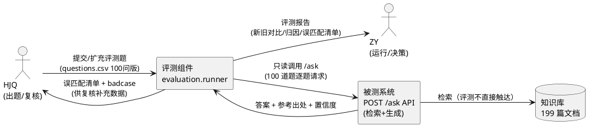
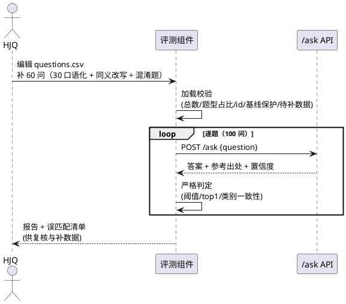
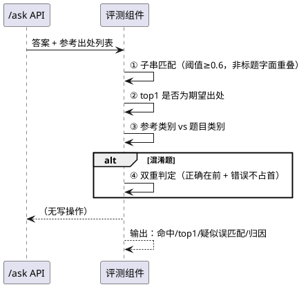
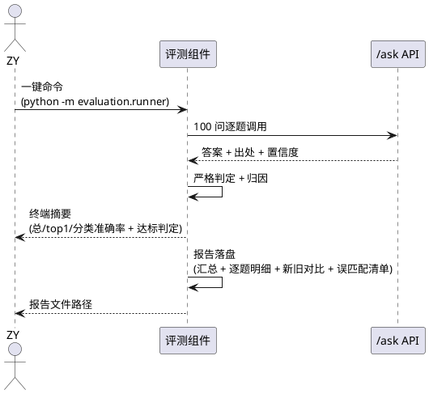

# 珠科百事通 · 评测集扩展与检索精度验证 需求规格（requirements.md）

- Feature：`eval_expansion_100q`
- 版本：v1.0（待评审）
- 日期：2026-10-10
- 依据：日志 2026-10-03/10-04、《任务通知-第2周》（HJQ：40→100 问、30 问口语化）、冲刺 3 目标（100 问评测 ≥85%）
- 格式：验收条件一律采用 EARS 句式（当…时，系统应当…；如果…，则系统应当…）

# **1. 组件定位**

## **1.1 核心职责**
本组件负责维护珠科百事通问答系统的评测集（40 问 → 100 问）并执行自动化评测，量化口语化问法下的真实检索精度，收紧判定标准以暴露误匹配。

## **1.2 核心输入**
1. **评测题数据**：HJQ 编辑扩充的 `evaluation/questions.csv`（100 问版，含口语化问法、同义改写、跨领域混淆题）
2. **评测运行指令**：ZY/HJQ 通过单条命令（`python -m evaluation.runner` 或等价一键命令）发起的全量评测请求
3. **被测系统响应**：`POST /ask` 接口返回的答案正文、参考出处标题、置信度

## **1.3 核心输出**
1. **终端评测摘要**：总命中率、top1 命中率、分类准确率、达标判定（≥85%）
2. **评测报告文件**：逐题明细 + 汇总统计 + 新旧成绩对比 + 错误用例归因清单
3. **疑似误匹配清单**：跨领域误匹配题目单列输出，格式与 HJQ 的 badcase 清单兼容

## **1.4 职责边界**
本组件**不负责**以下事项：
1. 检索链与生成回答算法本身的优化（由 retrieval 链负责，本组件只测量不修改）
2. 知识库文档的爬取、清洗、入库（由 crawler 负责；仅当新题缺少对应文档时在报告中标注"待补数据"）
3. 小程序、网页测试台的问答交互功能
4. `/ask` API 业务逻辑的任何变更（评测对被测系统只读调用）
5. 评测成绩的"美化"——报告须如实呈现口语化问法下的成绩回落

# **2. 领域术语**

**题库式问题**
: 与知识文档标题近似问法的问题，是当前 40 问基线的主要构成（例："四六级考试什么时候报名"）。

**口语化问法**
: 模拟真实学生日常表达、用词不照抄文档标题的问题（例："四六级啥时候报名""空调坏了找谁修"），100 问版中必须至少包含 30 问。

**同义改写题**
: 与既有题库式问题语义相同但换用不同词汇表达的问题（例："报修电话是多少" → "宿舍坏了打哪个电话找人"）。

**跨领域混淆题**
: 问题涉及易混淆的相邻领域词语，用于检验检索能否正确区分（例：朝鲜语专业八级 vs 英语专业八级报名通知）。

**基线**
: 既有 40 问评测集及其 97.5% 命中成绩；基线的题目内容、id、成绩须保留可回归。

**宽松判定**
: 现行判定缺陷——期望要点与文档标题字面子串重叠即判命中（n-gram 匹配率 30% 即通过），无法暴露误匹配。

**严格判定**
: 收紧后的判定标准：提高子串匹配门槛、引入 top1 精度与类别一致性校验，使成绩反映真实检索精度。

**误匹配**
: 检索返回了错误领域的文档（如"朝鲜语专业八级"问题命中"英语专业八级"文档）但被评测判为命中的情况。

**归因分类**
: 对未命中题目的失败原因分类：无对应文档（no_doc）、未召回（no_recall）、排序错误（rank_error）、判定过严（strict_judge）、服务异常（service_error）。

# **3. 角色与边界**

## **3.1 核心角色**
- **HJQ（数据质量与体验）**：出题扩充 questions.csv 至 100 问（含 30 问口语化），根据误匹配清单复核 badcase
- **ZY（队长）**：评审本需求，运行评测，依据量化成绩决定检索优化方向

## **3.2 外部系统**
- **`POST /ask` API（被测对象）**：评测只读调用，返回答案与参考出处
- **知识库（199 篇文档）**：新题的期望答案要点必须能对应到现有文档，否则标注"待补数据"
- **MaaS 三模型（bge-m3 / bge-reranker / deepseek-v4-flash）**：被测系统内部依赖，评测不直接调用

## **3.3 交互上下文**

# **4. DFX 约束**

## **4.1 性能**
1. 单题评测请求超时上限 60 秒（沿用现状：语义+重排+生成三连远程调用，单题 10-20s 属正常）。
2. 全量 100 问评测在单机串行模式下须在 45 分钟内完成。
3. 报告生成（含对比统计）须在评测完成后 10 秒内落盘。

## **4.2 可靠性**
1. 评测须可重复：同一评测集、同一系统状态下两次运行，逐题判定结果完全一致。
2. 中断容忍：单题请求失败（超时/非 200）不得终止全量评测，该题记为 service_error 并继续。
3. 基线保护：评测运行不得修改 questions.csv 既有 40 问的内容与 id。

## **4.3 安全性**
1. 评测集、评测报告、命令行输出中禁止出现 MaaS key 等环境变量敏感信息。
2. 评测对 /ask 的调用不携带任何写操作，不污染知识库数据。

## **4.4 可维护性**
1. 判定模式与阈值须有默认值并可通过命令行参数覆盖，报告中须记录本次所用判定标准，保证成绩可复现、可解释。
2. 报告统计口径固定（总命中率 / top1 命中率 / 题库式命中率 / 口语化命中率 / 混淆题正确率），供跨版本对比。

## **4.5 兼容性**
1. questions.csv 列结构向后兼容：现有 5 列（id、问题、类别、期望答案要点、来源）语义不变，新增列（如题型标记）为可选。
2. 既有 40 问基线永久保留：任何时候可仅针对基线子集回归评测。

# **5. 核心能力**

## **5.1 评测集扩展（40 问 → 100 问）**

### **5.1.1 业务规则**
1. **规模规则**：评测集总量须达到 100 问，其中新增 60 问、保留既有 40 问。
   a. 验收条件（EARS）：当评测集加载时，系统应当校验总题数 ≥ 100 且旧题 id 1-40 原样保留，不满足则报错退出。
2. **口语化占比规则**：60 个新增题中口语化问法不少于 30 问（任务通知硬指标）。
   a. 验收条件（EARS）：当评测集加载时，系统应当统计题型标记为口语化的题目数量，少于 30 问则告警提示。
3. **题型覆盖规则**：60 个新增题须覆盖三类题型——口语化问法、同义改写题、跨领域混淆题，且每类不少于 10 问。
   a. 验收条件（EARS）：当评测集加载时，系统应当校验三类题型各有 ≥10 问，缺类则告警提示。
4. **可判定性规则**：每道新题的期望答案要点须能在现有 199 篇知识文档中找到对应出处；暂缺文档的题须将"来源"标注为"待补数据"。
   a. 验收条件（EARS）：如果某题来源为"待补数据"，则系统应当在评测报告中将其单列并从主命中率统计中剔除，避免把数据缺失误判为检索失败。
5. **格式规则**：新题格式沿用 questions.csv 现有列结构，id 自 41 起连续编号、不得重复。
   a. 验收条件（EARS）：当评测集加载时，系统应当校验 id 唯一性与连续性，发现重复或缺失则报错并定位到具体行。
6. **禁止项**：禁止删除或改写既有 40 问的题目内容、id 与期望答案要点。
   a. 验收条件（EARS）：如果检测到既有 40 问中任一题的字段内容与基线版本不一致，则系统应当拒绝加载并提示差异明细，保证基线可回归。

### **5.1.2 交互流程**

### **5.1.3 异常场景**
1. **新题无对应文档**
   a. 触发条件：题目期望要点在 199 篇文档中找不到出处。
   b. 系统行为：该题记为 no_doc，从主命中率剔除并单列"待补数据"清单。
   c. 用户感知：报告中显示"⚠️ N 题缺少对应文档，已从主统计剔除"。
2. **题型占比不足**
   a. 触发条件：口语化题 < 30 问，或某题型 < 10 问。
   b. 系统行为：评测照常运行，但在报告头部输出醒目告警。
   c. 用户感知："⚠️ 口语化问法仅 X 问（要求 ≥30），请补题"。
3. **评测集格式错误**
   a. 触发条件：id 重复、必填列为空、类别超出枚举。
   b. 系统行为：拒绝加载，输出首个错误所在的行号与原因。
   c. 用户感知："❌ 第 N 行校验失败：<原因>，评测未启动"。

## **5.2 评测判定标准收紧**

### **5.2.1 业务规则**
1. **阈值提升规则**：现行 n-gram 子串匹配率 30% 即判中的标准须收紧，默认阈值提升至 ≥0.6，且可通过命令行参数配置。
   a. 验收条件（EARS）：当进行命中判定时，系统应当采用可配置的匹配阈值且默认值不低于 0.6，报告中记录实际使用值。
2. **标题字面匹配失效规则**：对题库式问题（期望要点≈文档标题），不得仅因问题与标题字面子串重叠而判中。
   a. 验收条件（EARS）：如果命中依据仅为参考文档标题与期望要点的字面重叠，那么系统应当要求答案正文或出处中包含要点完整核心词方可判中。
3. **top1 精度规则**：新增 top1 命中判定——期望出处是否排在参考列表首位，以区分"找到了"与"排第一"。
   a. 验收条件（EARS）：当评测完成时，系统应当对每题输出 top1 是否为期望出处的判定结果，并汇总 top1 命中率。
4. **类别一致性规则**：命中题目的参考文档类别须与题目类别一致，不一致即疑似误匹配。
   a. 验收条件（EARS）：如果命中题目的 top1 参考文档类别与题目类别不一致，则系统应当将其标记为疑似误匹配并计入误匹配清单。
5. **混淆题双重判定规则**：跨领域混淆题须同时验证"正确文档排在前列"与"错误领域文档未占据首位"。
   a. 验收条件（EARS）：当评测跨领域混淆题时，系统应当仅在正确出处进入参考列表前列且易混淆错误文档未排首位时判为命中。
6. **禁止项**：禁止在收紧判定时降低口语化题的判定难度以"凑成绩"——口语化题与题库式题使用同一套严格标准。
   a. 验收条件（EARS）：如果口语化题与题库式题使用了不同判定标准，则系统应当判定评测配置非法并拒绝输出成绩。

### **5.2.2 交互流程**

### **5.2.3 异常场景**
1. **收紧后成绩大幅回落**
   a. 触发条件：严格判定下总准确率显著低于基线（预期内现象，成绩回落是本任务目的之一）。
   b. 系统行为：照常输出真实成绩，并按归因分类标明回落来源（判定收紧 vs 检索真实失败）。
   c. 用户感知：报告中同时给出旧标准口径与新标准口径两套成绩，回落可解释。
2. **误匹配清单为空但人工发现误匹配**
   a. 触发条件：类别一致性校验未拦截的误匹配被人工复核发现。
   b. 系统行为：支持通过 badcase 清单人工补录，补录条目进入下一版报告对照。
   c. 用户感知：误匹配清单含"自动检出"与"人工补录"两个来源标记。

## **5.3 评测报告输出**

### **5.3.1 业务规则**
1. **一键运行规则**：单条命令完成 100 问全量评测，无需手工干预。
   a. 验收条件（EARS）：当执行评测命令（默认 `python -m evaluation.runner`）时，系统应当自动完成加载校验、逐题评测、判定、报告落盘全流程。
2. **总体成绩规则**：报告须输出总命中率、top1 命中率、达标判定（85% 线）。
   a. 验收条件（EARS）：当评测完成时，系统应当输出"命中数/总数、准确率 %"并与 85% 达标线比对给出达标/未达标结论。
3. **分类量化规则**：报告须按题型分列成绩，其中口语化问法准确率必须单独量化输出（本任务核心验收物）。
   a. 验收条件（EARS）：当评测完成时，系统应当分列输出题库式命中率、口语化命中率、混淆题正确率三组量化数字。
4. **新旧对比规则**：报告须包含 40 问基线成绩与本次成绩的对比。
   a. 验收条件（EARS）：当评测完成时，系统应当输出基线 97.5%（40 问）与本版成绩的对比，并对既有 40 问子集单独给出回归成绩。
5. **错误归因规则**：未命中题目须逐题给出归因分类与现场信息。
   a. 验收条件（EARS）：当某题未命中时，系统应当输出其归因分类（no_doc / no_recall / rank_error / strict_judge / service_error）、top1 参考标题与置信度，供人工复核。
6. **报告落盘规则**：评测结果须以文件形式留存，至少包含汇总报告与逐题明细各一份，且可追溯评测时间、评测集版本与判定标准。
   a. 验收条件（EARS）：当评测完成时，系统应当将汇总与逐题明细写入报告文件，文件中记录评测时间戳、题目数量、判定模式与阈值。
7. **badcase 兼容规则**：误匹配清单与未命中明细须能与 HJQ 的 badcase 清单工作流衔接（人工可读、可追加批注）。
   a. 验收条件（EARS）：如果 HJQ 需要复核错误用例，则系统应当提供可读的逐题明细文件，支持按题目 id 定位与追加人工批注列。

### **5.3.2 交互流程**

### **5.3.3 异常场景**
1. **服务不可用**
   a. 触发条件：/ask API 未启动或全部请求超时。
   b. 系统行为：评测启动前先探活，探活失败则直接退出不跑题。
   c. 用户感知："❌ /ask 服务无响应，请先启动服务（python start.py）"。
2. **单题失败**
   a. 触发条件：个别请求超时或返回非 200。
   b. 系统行为：该题记 service_error，评测继续，报告中单列失败题清单。
   c. 用户感知：报告显示"⚠️ N 题服务异常未判定，可重跑"。
3. **评测中途断开**
   a. 触发条件：评测进程被中断。
   b. 系统行为：已完成的题目明细不丢失，支持断点续跑或整体重跑。
   c. 用户感知：重跑后报告标注"本次为完整重跑/续跑"。

# **6. 数据约束**

## **6.1 评测题（questions.csv 行对象）**
1. **id**：唯一，1-100 连续编号；1-40 与基线完全一致，41-100 为新增题。
2. **问题**：非空，不超过 50 字；口语化题须使用日常表达（如"啥""哪个""谁""怎么办"）且不得照抄文档标题。
3. **类别**：取值限定枚举——教务-选课 / 教务-考试 / 教务-学籍 / 教务-规章制度 / 后勤-报修 / 后勤-交通 / 后勤-住宿 / 后勤-餐饮 / 后勤-卫生 / 后勤-安全 / 后勤-生活 / 后勤-通知 / 招生-政策 / 招生-奖助 / 招生-分数线。
4. **期望答案要点**：非空，1-3 个要点，以"、"分隔，每个要点为不超过 12 字的核心关键词。
5. **来源**：对应知识文档标题；文档暂缺时取值"待补数据"。
6. **题型标记（新增可选列）**：取值 colloquial（口语化）/ paraphrase（同义改写）/ confusable（跨领域混淆）/ baseline（基线旧题），缺省按 baseline 处理。

## **6.2 评测记录（逐题明细行对象）**
1. **题目信息**：id、问题、类别、题型标记。
2. **判定结果**：命中（是/否）、top1 命中（是/否）、类别一致（是/否）。
3. **现场信息**：置信度、top1 参考标题、参考类别。
4. **归因分类**：枚举 no_doc / no_recall / rank_error / strict_judge / service_error；命中题为空。

## **6.3 评测报告（汇总对象）**
1. **元信息**：评测时间戳、题目总数、判定模式与阈值、评测集版本（40 基线 / 100 版）。
2. **成绩指标**：总命中率、top1 命中率、题库式命中率、口语化命中率、混淆题正确率、既有 40 问子集回归成绩。
3. **对比信息**：基线 97.5%（40 问）与本版成绩对比、达标判定结论（85% 线）。
4. **问题清单**：未命中明细（含归因）、疑似误匹配清单（自动检出 + 人工补录）、待补数据题清单、服务异常题清单。

# **7. 验收标准汇总（对本任务的三条硬验收）**

1. **100 问评测可一键运行**
   EARS：当执行单条评测命令时，系统应当自动完成 100 问加载校验、逐题评测、判定与报告落盘，全程无需手工干预，且 45 分钟内完成。
2. **口语化问法准确率有量化报告**
   EARS：当评测完成时，系统应当单独输出口语化问法（≥30 问）的命中率量化数字，并与题库式问题成绩分列呈现，成绩回落须可解释（新旧口径对比 + 归因分类）。
3. **不破坏现有 40 问基线**
   EARS：当评测集扩展至 100 问时，系统应当保证既有 40 问的题目内容、id、期望要点原样保留，且报告须单独输出 40 问子集回归成绩以便与 97.5% 基线对比。
